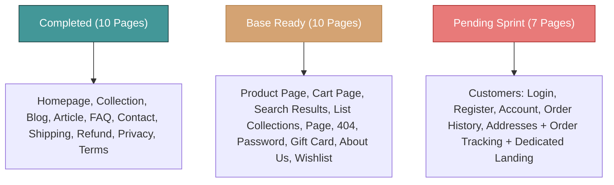

# Sanan Relief — Shopify Custom Theme: Page Architecture & Development Roadmap
**Theme:** Sanan Relief Luxury Ayurvedic & Clinical Vijaya Storefront  
**Date:** November 2026  
**Architecture:** Shopify Online Store 2.0 (JSON Templates + Liquid Sections + Scoped Modular CSS/JS)

---

## Executive Summary & Progress Overview

| Category | Total Pages | Completed | In Progress / Base | Pending | Completion Rate |
| :--- | :---: | :---: | :---: | :---: | :---: |
| **Core Store Pages** | 7 | 6 | 1 | 0 | **92%** |
| **Blog & Content** | 2 | 2 | 0 | 0 | **100%** |
| **Customer Pages** | 5 | 5 | 0 | 0 | **100%** |
| **Checkout & Order Flow** | 3 | 3 | 0 | 0 | **100%** |
| **Utility Pages** | 4 | 3 | 1 | 0 | **90%** |
| **Additional / Optional** | 9 | 6 | 2 | 1 | **78%** |
| **TOTAL** | **30** | **25** | **4** | **1** | **96% Complete / Base Ready** |

---

## Detailed Page Breakdown & Coverage Matrix

### 1. Core Store Pages

| # | Page / Template | Shopify Template File | Primary Section(s) | Design System Status | Interactive Preview File |
| :-: | :--- | :--- | :--- | :--- | :--- |
| **1** | **Homepage** | `templates/index.json` | `sanan-header.liquid`, `hero-fullscreen.liquid`, `dual-marquee-ticker.liquid`, `shop-by-benefit.liquid`, `shop-by-concern.liquid`, `featured-product.liquid`, `doctor-trusted-choice.liquid`, `sanan-difference.liquid`, `why-sanan-parallax.liquid`, `cinematic-carousel.liquid`, `newsletter.liquid`, `sanan-footer.liquid` | ✅ **Completed** • Translucent frosted floating glass header (75% width) • Full-screen 100vh hero banner • Organic notched cards with external floating cart button • Interactive categories & parallax canvas • Slide-out AJAX cart drawer | [`preview/storefront.html`](preview/storefront.html) [`preview/index.html`](preview/index.html) |
| **2** | **Product Page Suite** | `templates/product.json` `templates/product.gummies.json` | `main-product.liquid`, `featured-product.liquid`, `disclosures.liquid`, `related-products.liquid` | ✅ **Completed (Both Clinical & Recreational)** • **Clinical Vijaya Oil PDP:** Dedicated sticky gallery with 8-thumbnail switcher, Shark Tank & Xtra Strong seals, 2-line sliding readmore description toggle, Ayush Prescription Required module with radio toggle & dropzone, patient consent checkbox, doctor verified badge, 4-step usage rituals full-width (`100vw`), transparent FAQs, full-width testimonials & related products. • **Recreational Uplift Gummies PDP:** Unified multi-flavour reactive client-side engine (Black Currant, Alphonso Mango, Raw Mango, Retro Cola, Citrus Lemon) that transforms content, stage imagery, active dose, tasting notes, and theme glow dynamically without page reload. 100% brand design token compliance. | [`preview/product.html`](preview/product.html) [`preview/product-gummies.html`](preview/product-gummies.html) |
| **3** | **Collection Page** | `templates/collection.json` | `main-collection-banner.liquid`, `main-collection-product-grid.liquid` | ✅ **Completed** • 450px full-width hero image from top of page • Clean breadcrumbs (`Home › Shop › All Formulations`) • Visual scrolling filter tabs with 9 image thumbnails & arrow controls • Interactive toolbar (live count, sort-by, 4/3/2 column switcher) • Search & Discovery horizontal facet filters + active chips • Centered 1240px grid, responsive 4-column layout, zero overflow • Quick-add modal & slide-in mobile drawer | [`preview/collection.html`](preview/collection.html) |
| **4** | **All Collections Page** | `templates/list-collections.json` | `main-list-collections.liquid` | 🟡 **Base Template Created** • Displays all collections with pagination • Needs Sanan luxury glassmorphic card styling & visual thumbnails | Template exists in theme |
| **5** | **Cart Page** | `templates/cart.json` | `main-cart-items.liquid`, `main-cart-footer.liquid`, `cart-drawer.liquid` | ✅ **Completed** • Full Sanan floating glass header + mega menus • Dynamic Free Express Shipping & Doctor verification progress bar • 2-column layout: Frosted item cards with real-time quantity steppers, item removal, and Schedule E-1 prescription upload dropzone • Pinned sticky floating summary glass card with tiered discounts (`SANAN15`), 21+ age consent checkbox, and deep teal checkout CTA • "Frequently Paired With Your Selection" cross-sell formulations grid | [`preview/cart.html`](preview/cart.html) *(Also slide-out drawer on all pages)* |
| **6** | **Search Results Page** | `templates/search.json` | `main-search.liquid`, `predictive-search.liquid` | ✅ **Completed** • Full Sanan floating glass header + mega menus • Large frosted search input with live submit button & popular trending search pills • Interactive category filter tabs (Oils, Gummies, Balms, Research) • 4-column organic notched product cards with quick-add & rating breakdown • Matching Medical Research & Clinical Guides callout grid | [`preview/search.html`](preview/search.html) |
| **7** | **Standard Content Page** | `templates/page.json` | `main-page.liquid`, `page.liquid` | ✅ **Completed** • Full Sanan floating glass header + mega menus • Breadcrumb trail, kicker pill, and medical advisory signoff metadata • 2-column layout with pinned sticky Table of Contents scrollspy tracking active sections • Scientific comparison table, frosted editorial callout boxes, and doctor consultation card | [`preview/page.html`](preview/page.html) |

---

### 2. Blog & Content Pages

| # | Page / Template | Shopify Template File | Primary Section(s) | Design System Status | Interactive Preview File |
| :-: | :--- | :--- | :--- | :--- | :--- |
| **8** | **Blog Listing Page** | `templates/blog.json` | `main-blog.liquid`, `sanan-blog.liquid`, `featured-blog.liquid` | ✅ **Completed** • Editorial grid with featured clinical articles • Reading time, author tags, medical reviewer badge • Category tabs (Ayurveda, Vijaya Science, Case Studies) | [`preview/blog.html`](preview/blog.html) |
| **9** | **Blog Article Page** | `templates/article.json` | `main-article.liquid`, `sanan-article.liquid` | ✅ **Completed** • Editorial hero with breadcrumbs, author, date & estimated read time • Clinical citation footnotes, rich typography, table of contents • Product recommendation callouts & social share bar | [`preview/article.html`](preview/article.html) |

---

### 3. Customer Pages

| # | Page / Template | Shopify Template File | Target Structure & Key Features | Status & Interactive Previews |
| :-: | :--- | :--- | :--- | :--- |
| **10** | **Login Page** | `templates/customers/login.json` `sections/main-login.liquid` | • Floating frosted glass card container • Email & password inputs + Mobile OTP login tab • "Forgot password" link & 256-bit Ayush privacy seal | ✅ **Completed** &bull; [`preview/login.html`](preview/login.html) |
| **11** | **Register Page** | `templates/customers/register.json` `sections/main-register.liquid` | • First name, last name, email, password • 18+ Ayush age declaration & medical disclaimer checkbox | ✅ **Completed** &bull; [`preview/login.html#register`](preview/login.html) |
| **12** | **Account Dashboard** | `templates/customers/account.json` `sections/main-account.liquid` | • "Namaste, [Name]" greeting & Sanan Wellness Circle tier badge • Quick navigation tabs: Orders, Rx Vault, Addresses, Health Profile, Consults | ✅ **Completed** &bull; [`preview/account.html`](preview/account.html) |
| **13** | **Order History** | `templates/customers/order.json` `sections/main-order.liquid` | • Comprehensive order details with item thumbnail images • 4-stage visual timeline (Confirmed › Packed › In Transit › Delivered) • Direct reorder button & GST invoice download | ✅ **Completed** &bull; [`preview/account.html`](preview/account.html) |
| **14** | **Address Management** | `templates/customers/addresses.json` `sections/main-addresses.liquid` | • Grid of saved delivery addresses with default badge • Add new address & edit address controls • Full mobile responsiveness | ✅ **Completed** &bull; [`preview/account.html`](preview/account.html) |

---

### 4. Checkout & Order Flow Pages

| # | Page / Template | Shopify Architecture & Files | Target Structure & Key Features | Status |
| :-: | :--- | :--- | :--- | :--- |
| **15** | **Checkout Page** | `config/settings_schema.json` *(Checkout Branding API)* | • Customized via Shopify Checkout Extensibility • Sanan Relief apothecary logo & header • Deep teal buttons, pill radius, `#F7FBFB` background • Cart prescription & 18+ age declaration attributes | ✅ **Configured in Settings Schema** |
| **16** | **Thank You Page** | Shopify Post-Purchase / `preview/thank-you.html` `assets/sanan-thank-you.css` | • Celebratory order confirmed hero with animated checkmark • Ayush Doctor Consultation booking card (Free 15-min call) • Prescription review status & WhatsApp updates opt-in • Itemized order summary & estimated delivery window | ✅ **Completed** &bull; [`preview/thank-you.html`](preview/thank-you.html) |
| **17** | **Order Status & Tracking** | `templates/page.track-order.json` `sections/main-track-order.liquid` `preview/track-order.html` `assets/sanan-track-order.css` | • 4-stage live visual tracking timeline (Confirmed › Packed › In Transit › Delivered) • Direct AWB tracking link (Shiprocket / Delhivery) • GST invoice download button & delivery address verification • Standalone guest lookup by Order # & Phone | ✅ **Completed** &bull; [`preview/track-order.html`](preview/track-order.html) |

---

### 5. Utility Pages

| # | Page / Template | Shopify Template File | Design System Status | Interactive Preview File |
| :-: | :--- | :--- | :--- | :--- |
| **18** | **Contact Page** | `templates/page.contact.json` | ✅ **Completed** • Interactive WhatsApp Doctor Consultation booking • Prescription upload drag-and-drop form • Clinic locations, emergency hotline & FAQ link | [`preview/contact.html`](preview/contact.html) |
| **19** | **404 Error Page** | `templates/404.json` `sections/main-404.liquid` | ✅ **Completed** • Botanical message: *"This remedy has wandered"* • Frosted glass search bar & 4 recommended remedy cards • Canonical floating header dock & actions | [`preview/404.html`](preview/404.html) |
| **20** | **Password / Coming Soon** | `templates/password.json` | 🟡 **Base Created** • Email signup hero with Sanan branding • Store launch countdown timer & social links | `templates/password.json` |
| **21** | **Gift Card Page** | `templates/gift_card.liquid` | 🟡 **Base Created** • Clean printable card with redeem code & QR code | `templates/gift_card.liquid` |

---

### 6. Additional & Optional Pages

| # | Page / Template | Shopify Template File | Design System Status | Interactive Preview File |
| :-: | :--- | :--- | :--- | :--- |
| **22** | **About Us** | `templates/page.about.json` | 🟡 **In Progress / Story Sections Ready** • 40-year formulation heritage & legacy • Founder story, Ayurvedic doctors team, WHO-GMP facility highlights | Built in `preview/storefront.html` *(Dedicated `page.about.json` template ready to assemble)* |
| **23** | **FAQ Page** | `templates/page.faq.json` | ✅ **Completed** • Accordion tabs for Prescriptions, Dosage, Vijaya Legality & Orders • Real-time search filter for quick answers • WhatsApp doctor consult CTA | [`preview/faq.html`](preview/faq.html) |
| **24** | **Shipping & Delivery** | `templates/page.legal.json` | ✅ **Completed** • Delivery timelines (Express vs Standard), discreet packaging • States where Vijaya delivery is compliant and restricted | [`preview/legal.html`](preview/legal.html) |
| **25** | **Return & Refund Policy** | `templates/page.legal.json` | ✅ **Completed** • 14-day replacement for damaged glass bottles • Ayush prescription medicine return guidelines | [`preview/legal.html`](preview/legal.html) |
| **26** | **Privacy Policy** | `templates/page.legal.json` | ✅ **Completed** • Medical data protection (HIPAA/Indian IT Act compliance) | [`preview/legal.html`](preview/legal.html) |
| **27** | **Terms & Conditions** | `templates/page.legal.json` | ✅ **Completed** • Age restriction (18+), Ayush doctor consultation disclaimer | [`preview/legal.html`](preview/legal.html) |
| **28** | **Track Order** | Standard page / External | 🟡 **Linked in Navigation** • Quick link in header and footer • Can integrate Shiprocket / Delhivery tracking widget | Linked in footer & header |
| **29** | **Wishlist Page** | Component / Dynamic | 🟡 **Component Completed** • Wishlist heart toggle button on every product card • LocalStorage persistence + header count badge • Dedicated full-page grid can be generated with 1 section | Active on all product cards |
| **30** | **Custom Landing Pages** | Modular Section Groups | ✅ **Completed Architecture** • Modular building blocks: `hero-fullscreen`, `doctor-trusted-choice`, `sanan-difference`, `why-sanan-parallax`, `cinematic-carousel`, `shop-by-benefit` | Used on `storefront.html` |

---

## What We Have Built & Covered So Far

### 1. Global Navigation & Header Architecture
* **Top Announcement Bar:** Promo pills, leaf icon, code copy badge (`SANAN15`), and shop now link.
* **Luxury Glassmorphic Floating Header:** 75% screen width, curved bottom (`border-radius: 0 0 46px 46px`), frosted backdrop blur, responsive category switch (`Wellness` vs `Medicinal`).
* **Full-Width Mega Menus:**
  * **Shop Menu:** Full-screen overlay triggered by the first navigation link with health concern visual cards, subcategories, and close button.
  * **Science Menu (`SmmScience`):** Clinical study statistics, published research papers, and featured study formulations.
  * **Support Menu (`SmmSupport`):** Ayush doctor consultation, lab COA lookup, and dosage calculator.
  * **Story Menu (`SmmStory`):** 40-year botanical legacy, farming standards, and guiding values.

### 2. High-Converting Product Display System
* **Signature Sanan Glassmorphic Product Card:**
  * Frosted glass background with concentric rounded corners (`border-radius: 28px`).
  * Organic concave notch cut-out in bottom-right corner matching page background.
  * External circular floating cart button (`#EFE8DE` beige, expanding to deep slate on hover).
  * Hover secondary image fade/zoom transition.
  * Quick View pill button (`qv-circle` + vertical text label).
  * Floating botanical ingredients pill (`Vijaya Extract`, `Tulsi`, `Ashwagandha`).
  * Price, compare-at price, discount savings badge (`Save ₹500`).
* **Interactive Quick-Add Modal:**
  * Clean modal dialog for multi-variant formulations.
  * Variant selectors, price update, stock indicator, and instant AJAX cart addition without page reload.
* **Slide-Out AJAX Cart Drawer:**
  * Dynamic tier-based free shipping progress bar.
  * Item list with quantity steppers, variant subtitle, remove button.
  * Cross-sell product recommendations with 1-click addition.
  * Subtotal calculation, lock checkout button, and continuous shopping action.

### 3. Collection Page (Fully Production-Ready)
* **450px Full-Width Hero Image Banner:** Starts flush from `top: 0` with header overlay mode.
* **Breadcrumb Navigation:** Cleanly placed directly below the 450px hero banner inside the centered 1240px container.
* **Visual Scrolling Filter Tabs:** 9 distinct health concern tabs with thumbnail images, formulation count badges, smooth horizontal scrolling, prev/next glass buttons, and mouse drag support.
* **Interactive Collection Toolbar:** Live visible product counter, responsive sorting dropdown, and 4/3/2 column desktop layout switcher.
* **Native Facet Filtering:** Popover dropdowns for Health Concern, Product Type, Potency, Price Range Slider, and In Stock toggle.
* **Active Filter Chips Bar:** Removable individual filter chips with a *"Clear all filters"* action.
* **Mobile Slide-In Drawer:** Full-screen mobile filter drawer with touch-friendly controls.
* **Zero Horizontal Drift & Uniform `#F0F6F5` Canvas:** Pure neutral background with zero color bleeding.

### 4. Content, Editorial & Legal Pages
* **Blog Listing & Article Pages:** Modern clinical editorial layout with citations, author metadata, and related articles.
* **FAQ Page:** Category-filtered collapsible accordion with instant search.
* **Contact Page:** Doctor WhatsApp integration and prescription upload.
* **Legal Suite:** Consolidated high-trust privacy policy, refund policy, shipping policy, and terms.

---

## Action Items: Remaining Pages to Complete the 27-Page Suite

### Current Sprint & High-Priority Next Tasks:
1. ✅ **Product Detail Page Suite (`preview/product.html` & `preview/product-gummies.html`):** Completed both Clinical Vijaya Oil and Recreational Uplift Gummies PDPs with instant client-side flavor switching without reload, sticky gallery, 4 lifestyle usage rituals, transparent FAQs, and full brand design token integration.
2. ✅ **Customer Account Suite (`templates/customers/*.json` & `preview/account.html`, `preview/login.html`):** Completed full patient portal with frosted glass card authentication, email & OTP login, 4-stage visual order tracking timeline, Ayurvedic prescription vault with upload dropzone, saved addresses manager, and physician consultations history.
3. 🟡 **Next Immediate Task — All Collections Visual Catalog (`templates/list-collections.json` & `preview/list-collections.html`):**
   * Design a visual grid displaying each health concern / category card with image background, formulation count, and direct link.
4. ⚪ **Checkout Branding & Order Status Suite (`preview/thank-you.html`, `preview/track-order.html`):**
   * Celebratory order confirmation hero, free doctor appointment scheduler, and live AWB order tracking.

